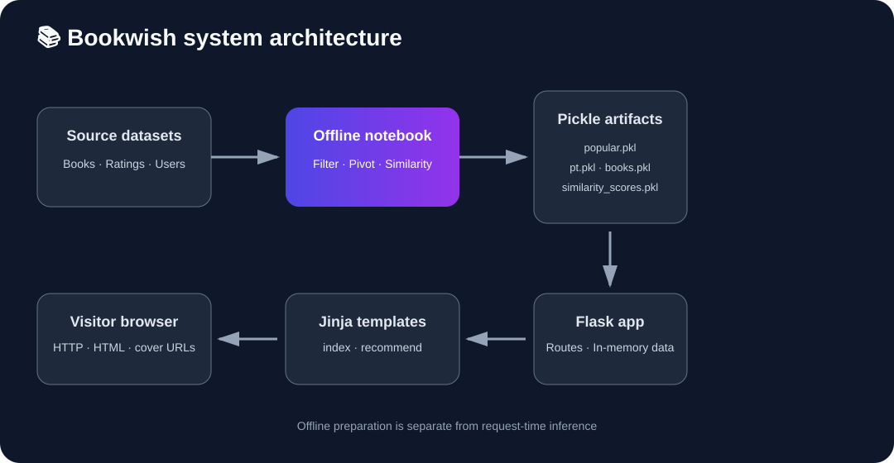
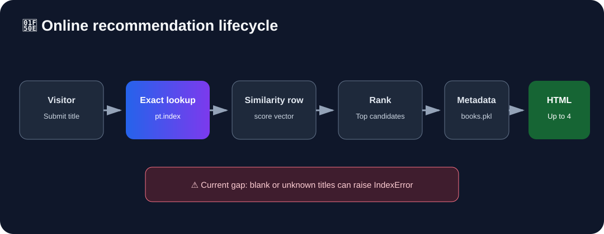
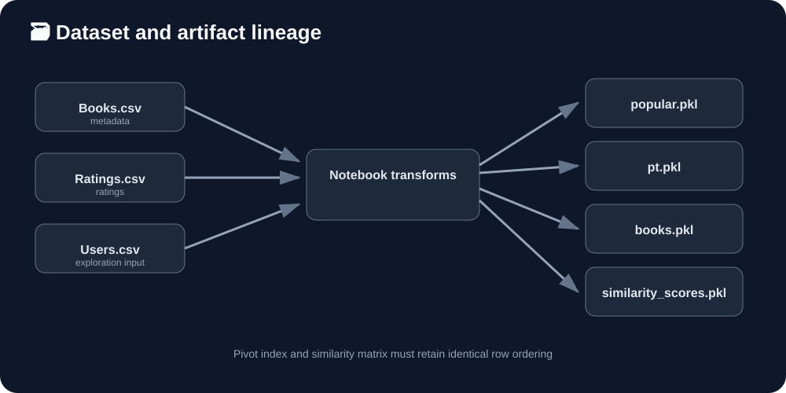

# 📚 Book Recommendation System | Bookwish

<p align="center">
  
</p>

<p align="center">
  <b>A Flask-based book discovery demo powered by precomputed item-item collaborative filtering.</b>
</p>

[](https://github.com/Brajesh31/Book-Recommender/actions/workflows/quality.yml)
[](https://github.com/Brajesh31/Book-Recommender/actions/workflows/security.yml)


[](https://github.com/Brajesh31/Book-Recommender/issues)
[](https://github.com/Brajesh31/Book-Recommender/stargazers)

> [!IMPORTANT]
> **Project status: educational/demo application.** The current app requires an exact, case-sensitive title match. Blank and unknown titles now receive explicit HTTP error feedback, and the direct-run entry point disables debug mode. The app still loads Python pickle artifacts at import time, so only trusted model files may be used. Do not expose the development server or load untrusted pickle files. Read [Security](SECURITY.md) before deployment.

## 🧭 Contents

- [✨ Project overview](#-project-overview)
- [🎯 Features and current scope](#-features-and-current-scope)
- [🧠 How recommendations work](#-how-recommendations-work)
- [🏗️ Architecture](#️-architecture)
- [🔄 Workflows and diagrams](#-workflows-and-diagrams)
- [🗂️ Project structure](#️-project-structure)
- [🧰 Technology stack](#-technology-stack)
- [⚙️ Requirements](#️-requirements)
- [🚀 Installation and setup](#-installation-and-setup)
- [▶️ Run locally](#️-run-locally)
- [🌐 Application routes](#-application-routes)
- [📓 Model notebook and artifacts](#-model-notebook-and-artifacts)
- [🧪 Testing and quality](#-testing-and-quality)
- [🔐 Security, privacy, and accessibility](#-security-privacy-and-accessibility)
- [⚠️ Current limitations](#️-current-limitations)
- [📚 Documentation index](#-documentation-index)
- [🤝 Contributing](#-contributing)
- [🛣️ Roadmap](#️-roadmap)
- [📄 License and data rights](#-license-and-data-rights)

## ✨ Project overview

**Bookwish** is a small server-rendered Flask website for browsing a precomputed popular-books list and discovering titles similar to a selected book. The application uses Python, pandas, NumPy, Jinja templates, and precomputed model artifacts.

The project separates offline data preparation from online inference:

- **Offline:** the notebook processes book metadata and ratings, creates a user-title pivot table, computes item similarity, and exports pickle files.
- **Online:** Flask loads those files into memory, handles browser requests, ranks candidate books, and renders HTML.

There is no visitor account system, persistent preference store, database, or live model training in the current implementation.

## 🎯 Features and current scope

| Feature | What the repository currently does | Status |
|---|---|---|
| 🏆 Popular books | Displays the precomputed popular list from `popular.pkl` | Implemented |
| 🔎 Similar-book search | Accepts a title and performs exact index lookup | Implemented, limited |
| 📚 Recommendation cards | Displays up to four candidates with title, author, and cover URL | Implemented |
| 🧮 Collaborative filtering | Uses precomputed item-item similarity values | Offline notebook workflow |
| 🗃️ Dataset processing | Uses books, ratings, and user CSV files | Notebook workflow |
| 👤 Personal accounts | No authentication or user profiles | Not implemented |
| 💾 Saved books | No persistent visitor preferences | Not implemented |
| 🔌 JSON API | Routes return rendered HTML | Not implemented |
| 🔄 Online retraining | Model is not retrained per request | Not implemented |

## 🧠 How recommendations work

The notebook documents the following filtering and transformation process:

1. Load book metadata and rating records.
2. Retain users with more than 200 ratings.
3. Retain books with at least 50 ratings.
4. Construct a user-by-book rating pivot table.
5. Fill missing ratings with zero.
6. Calculate cosine similarity between book vectors.
7. Build a popularity ranking using titles with at least 250 ratings.
8. Keep the top 50 popular titles by average rating.
9. Export the resulting objects as pickle artifacts.

At request time, Flask finds the submitted title in `pt.index`, reads the corresponding similarity row, sorts candidates by score, skips the selected title, and resolves metadata from `books.pkl`.

<p align="center">
  
</p>

**Important model invariant:** row `i` in `similarity_scores.pkl` must correspond to `pt.index[i]`. All model files must come from the same build.

See [Model Methodology](docs/model-methodology.md) for the detailed process and evaluation requirements.

## 🏗️ Architecture

<p align="center">
  
</p>

### Runtime components

| Component | Responsibility |
|---|---|
| `app.py` | Loads artifacts and defines Flask routes |
| `templates/index.html` | Popular-books page |
| `templates/recommend.html` | Recommendation form and results |
| `popular.pkl` | Popularity table |
| `pt.pkl` | Title-indexed pivot table |
| `books.pkl` | Book metadata lookup |
| `similarity_scores.pkl` | Item-item similarity matrix |
| `book_recommendation_model.ipynb` | Offline analysis and model preparation |

The application has no database or separate API service. Pickle objects are loaded into process memory during module import.

## 🔄 Workflows and diagrams

- [System architecture source](docs/diagrams/architecture.mmd)
- [Recommendation pipeline source](docs/diagrams/recommendation-pipeline.mmd)
- [HTTP request sequence](docs/diagrams/request-sequence.mmd)
- [Data lineage](docs/diagrams/data-lineage.mmd)
- [Rendered SVG diagrams](assets/diagrams/README.md)

## 🗂️ Project structure

```text
Book-Recommender/
├── .github/
│   ├── ISSUE_TEMPLATE/              # Bug, feature, and documentation forms
│   ├── workflows/                  # Quality, security, and README workflows
│   ├── PULL_REQUEST_TEMPLATE.md
│   └── dependabot.yml
├── assets/
│   └── diagrams/                   # Original SVG architecture and flow visuals
├── docs/
│   ├── diagrams/                   # Mermaid source diagrams
│   ├── templates/                  # ADR, test, incident, data, release templates
│   ├── README.md                   # Documentation index
│   ├── architecture.md
│   ├── model-methodology.md
│   ├── data-dictionary.md
│   ├── api.md
│   ├── security.md
│   ├── privacy.md
│   ├── accessibility.md
│   ├── testing.md
│   ├── deployment.md
│   └── ...                         # Operations, performance, support, and guides
├── templates/
│   ├── index.html                  # Popular books
│   └── recommend.html              # Search and recommendation results
├── Books.csv                       # Git LFS source data
├── Ratings.csv                     # Git LFS ratings data
├── Users.csv                       # Git LFS user attributes
├── app.py                          # Flask entry point and routes
├── book_recommendation_model.ipynb # Offline model workflow
├── books.pkl                       # Git LFS model artifact
├── popular.pkl                     # Git LFS model artifact
├── pt.pkl                          # Git LFS model artifact
├── similarity_scores.pkl           # Git LFS model artifact
├── requirements.txt
├── CODE_OF_CONDUCT.md
├── CONTRIBUTING.md
├── LICENSE
├── README.md
├── ROADMAP.md
├── SECURITY.md
└── SUPPORT.md
```

For the full explanation of each important file, see [Project Structure](docs/project-structure.md).

## 🧰 Technology stack

| Technology | Role |
|---|---|
| Python | Application and model workflow |
| Flask | Server-side routing and rendering |
| NumPy | Similarity array operations |
| pandas | DataFrames and preprocessing |
| Jinja2 | HTML templates through Flask |
| scikit-learn | Notebook cosine similarity dependency, not currently listed in runtime requirements |
| Gunicorn | Production WSGI server |
| Git LFS | Large CSV, notebook, and pickle storage |

## ⚙️ Requirements

- Python 3 and pip.
- Git and Git LFS.
- A compatible Python environment for the committed pickle artifacts.
- Jupyter and scikit-learn if rerunning the notebook.
- Sufficient memory for the loaded model objects. Multiple WSGI workers may each load their own copy.

Dependency versions are currently unpinned. See [Dependencies](docs/dependencies.md) and [Compatibility](docs/compatibility.md).

## 🚀 Installation and setup

### 1. Clone with Git LFS

```bash
git lfs install
git clone https://github.com/Brajesh31/Book-Recommender.git
cd Book-Recommender
git lfs pull
```

Confirm that `Books.csv`, `Ratings.csv`, `Users.csv`, the notebook, and all four pickle artifacts are real files, not short Git LFS pointer text.

### 2. Create a virtual environment

Windows PowerShell:

```powershell
py -m venv .venv
.\.venv\Scripts\Activate.ps1
python -m pip install --upgrade pip
pip install -r requirements.txt
```

macOS/Linux:

```bash
python3 -m venv .venv
. .venv/bin/activate
python -m pip install --upgrade pip
pip install -r requirements.txt
```

### 3. Verify runtime dependencies

```bash
python -c "import flask, numpy, pandas; print('Runtime imports OK')"
python -m py_compile app.py
```

These checks do not validate pickle safety or artifact compatibility. Only load trusted artifacts.

## ▶️ Run locally

From the repository root:

```bash
python app.py
```

Open <http://127.0.0.1:5000>. The direct-run path keeps debug mode disabled. For production, use Gunicorn or a managed WSGI server.

### Production WSGI example

```bash
gunicorn --workers 2 --bind 0.0.0.0:8000 app:app
```

Choose workers based on measured memory use. Configure HTTPS, network controls, process supervision, and resource limits at the hosting layer. See [Deployment](docs/deployment.md).

## 🌐 Application routes

| Method | Path | Purpose | Response |
|---|---|---|---|
| `GET` | `/` | Render popular books | HTML |
| `GET` | `/recommend` | Render title form | HTML |
| `POST` | `/recommend_books` | Find similar books from `user_input` | HTML |

The POST field must currently match a title in the trained index exactly. The routes do not form a versioned JSON API. See [API and Routes](docs/api.md).

## 📓 Model notebook and artifacts

The notebook currently reads CSV files from a Colab-style `/content/` path. Local execution requires adapting those paths. The notebook imports scikit-learn, which is not listed in the current `requirements.txt`.

| Artifact | Role |
|---|---|
| `popular.pkl` | Top popular book records |
| `pt.pkl` | Title-indexed user-rating pivot |
| `books.pkl` | Metadata lookup table |
| `similarity_scores.pkl` | Similarity matrix aligned with pivot rows |

**Pickle warning:** Python pickle deserialization can execute code. Never load a model artifact from an untrusted contributor, upload, or URL. See [Security Review](docs/security.md).

## 🧪 Testing and quality

The pytest suite checks Jinja rendering and escaping, plus key Flask routes using mocked in-memory artifacts. It does not validate real model files, recommendation quality, or accessibility conformance. The GitHub Actions quality workflow runs these tests, compiles Python and Jinja templates, and checks core docs/assets. A separate scheduled security workflow audits declared Python dependencies.

Run the checks locally:

```bash
pip install -r requirements.txt
pip install -r requirements-dev.txt
python -m py_compile app.py tests/test_app.py tests/test_templates.py
pytest -q
```

The current route tests use mocked model artifacts. They do not validate the real pickle bundle, model quality, or accessibility conformance. See [Testing Strategy](docs/testing.md).

## 🔐 Security, privacy, and accessibility

- **Security:** pickle trust and artifact integrity still require attention. Input validation and safe debug defaults have been added. See [SECURITY.md](SECURITY.md) and [Security Review](docs/security.md).
- **Privacy:** source data includes user identifiers, location, and age fields. Verify rights and minimize personal data. See [Privacy](docs/privacy.md).
- **Accessibility:** labels, descriptive image alternatives, skip links, and visible focus styles have been added. Manual keyboard, screen-reader, and contrast testing remains. See [Accessibility](docs/accessibility.md).

## ⚠️ Current limitations

- Exact and case-sensitive title matching only.
- Blank and unknown titles are handled with HTTP 400/404 feedback, but matching remains exact and case-sensitive.
- No account system, personalized visitor history, or saved preferences.
- No database or JSON API.
- Pickle artifacts load during module import without an explicit compatibility manifest.
- Flask debug mode is enabled by the direct-run entry point.
- Notebook paths assume `/content/`.
- scikit-learn is not listed in `requirements.txt`.
- Dependencies are not pinned.
- Dataset provenance, license, privacy terms, and cover-image rights are not established in this repository.
- No automated application test suite or verified model-quality metrics are included.

See the detailed [Limitations Register](docs/limitations.md) and [Technical Debt](docs/technical-debt.md).

## 📚 Documentation index

| Topic | Guide |
|---|---|
| Documentation hub | [docs/README.md](docs/README.md) |
| Product overview | [Overview](docs/overview.md) |
| Requirements | [Requirements](docs/requirements.md) |
| Architecture | [Architecture](docs/architecture.md) |
| Project structure | [Project Structure](docs/project-structure.md) |
| Installation and configuration | [Installation](docs/installation.md) · [Configuration](docs/configuration.md) |
| Development and workflows | [Development](docs/development.md) · [Workflows](docs/workflows.md) |
| Routes and data | [API](docs/api.md) · [Database](docs/database.md) · [Data Dictionary](docs/data-dictionary.md) |
| Model methodology | [Model Methodology](docs/model-methodology.md) |
| Security and privacy | [Security](docs/security.md) · [Privacy](docs/privacy.md) |
| Accessibility and testing | [Accessibility](docs/accessibility.md) · [Testing](docs/testing.md) |
| Performance and compatibility | [Performance](docs/performance.md) · [Compatibility](docs/compatibility.md) |
| Operations and deployment | [Operations](docs/operations.md) · [Deployment](docs/deployment.md) · [Release Process](docs/release-process.md) |
| Errors and support | [Error Handling](docs/error-handling.md) · [Troubleshooting](docs/troubleshooting.md) · [FAQ](docs/faq.md) |
| Maintenance | [Dependencies](docs/dependencies.md) · [Technical Debt](docs/technical-debt.md) · [Limitations](docs/limitations.md) |
| Reference | [Commands](docs/commands.md) · [Examples](docs/examples.md) · [Glossary](docs/glossary.md) · [References](docs/references.md) |

## 🤝 Contributing

Contributions should be focused, tested, and documented. Read [CONTRIBUTING.md](CONTRIBUTING.md) and [CODE_OF_CONDUCT.md](CODE_OF_CONDUCT.md). Use GitHub issue and pull request templates. Report suspected vulnerabilities privately through [SECURITY.md](SECURITY.md), never in a public issue.

## 🛣️ Roadmap

See [ROADMAP.md](ROADMAP.md) for planned product, model, security, and quality improvements. Roadmap items are proposals, not completed capabilities.

## 📄 License and data rights

The project source is provided under the MIT License. See [LICENSE](LICENSE). The MIT source license does not automatically grant rights to the datasets, ratings, user attributes, derived model data, or book-cover images. Verify each source's terms before redistributing or deploying those materials.

---

<p align="center">
  Built for book discovery 📚 · <a href="docs/README.md">Explore the documentation</a> · <a href="CONTRIBUTING.md">Contribute</a>
</p>

Last updated: 2026-11-16 20:11 UTC
