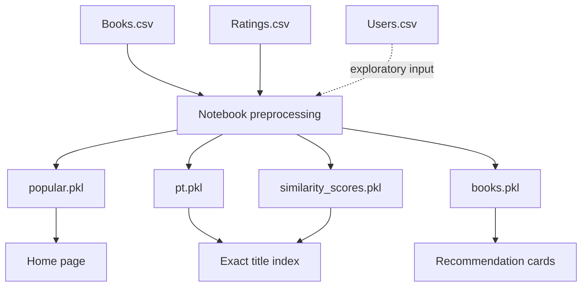

# 🗃️ Data Dictionary and Artifact Lineage

## 1. Purpose

This reference describes the three checked-in CSV inputs and four runtime pickle artifacts. The repository stores the CSV, notebook, and pickle files using Git LFS rules. A checkout must contain actual LFS objects, not pointer text, before the notebook or application can use them.

## 2. Source CSVs

| File | Columns | Meaning / handling |
|---|---|---|
| `Books.csv` | ISBN, Book-Title, Book-Author, Year-Of-Publication, Publisher, Image-URL-S, Image-URL-M, Image-URL-L | Book metadata and external image references |
| `Ratings.csv` | User-ID, ISBN, Book-Rating | User-to-book rating events |
| `Users.csv` | User-ID, Location, Age | User attributes; treat as potentially personal data |

### Data quality checks to perform

- Verify file encoding and CSV quoting.
- Check required columns and duplicate identifiers.
- Inspect missing titles, authors, ISBN values, and cover URLs.
- Check invalid publication years and rating bounds.
- Examine duplicate user/book pairs and define aggregation behavior.
- Confirm whether location and age are actually needed for the workflow.
- Check for unusually large or malformed values before preprocessing.

Do not infer the original data publisher or license from the filenames. The repository does not currently supply a verified provenance record.

## 3. Derived runtime files

| Artifact | Consumer | Expected content |
|---|---|---|
| `popular.pkl` | `GET /` | Popular title table with author, cover URL, rating count, and average rating |
| `pt.pkl` | `POST /recommend_books` | User-title rating pivot table indexed by title |
| `books.pkl` | Recommendation result lookup | Book metadata indexed through title filtering |
| `similarity_scores.pkl` | Recommendation ranking | Two-dimensional similarity array aligned with pivot rows |

These are Python pickle files. Their content must be generated and reviewed by a trusted process. Do not preview an unknown pickle by blindly loading it.

## 4. Lineage

## 5. Privacy and licensing boundaries

The MIT license applies to the project source as stated in the root license file. It does not prove permission to redistribute dataset rows, user ratings, demographic information, or book cover images. Before public deployment:
- identify the source and license of each dataset,
- verify permitted use and redistribution,
- minimize retention of user-level data,
- remove data that is not required,
- check third-party image hosting terms,
- document any attribution obligations.

See [Privacy](privacy.md) and [Security](security.md).

## 6. Future dataset manifest

A future `data/manifest.yml` should record, for each source:
- logical name and file path,
- provider and acquisition date,
- version or snapshot identifier,
- license and permitted use,
- checksum,
- personal-data classification,
- retention and deletion requirements,
- transformation and derived artifact lineage.

Do not fill this manifest with guessed sources or fabricated licenses.
