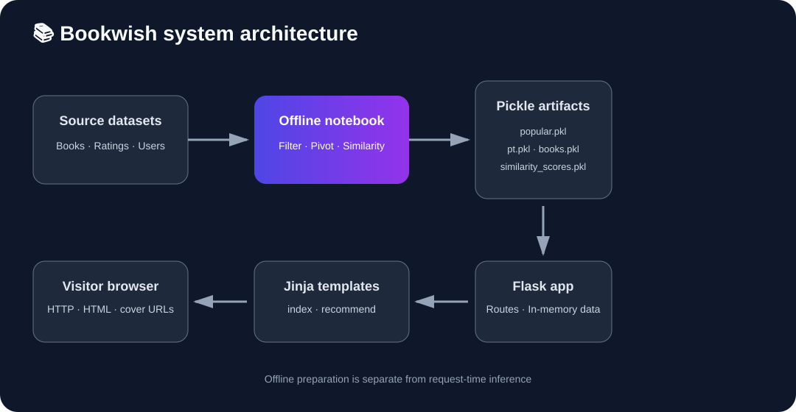
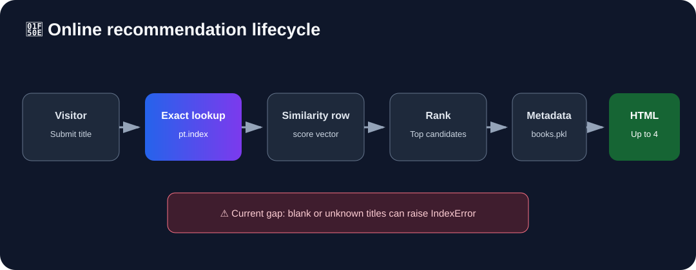
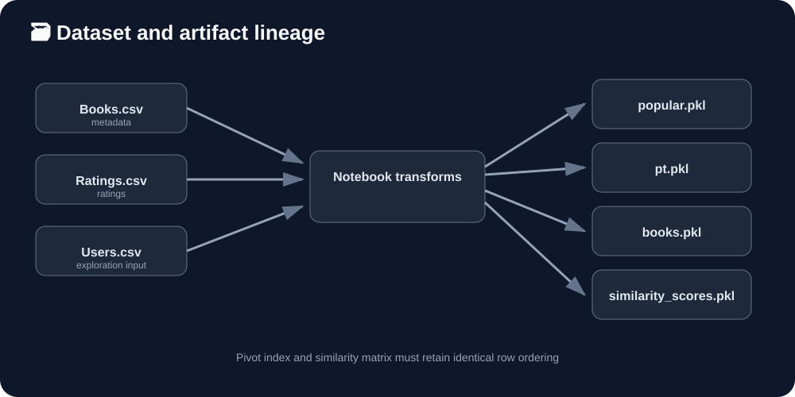

# 🗺️ Diagram Catalogue

These Mermaid sources describe the actual current Flask application and offline data-preparation workflow.

| Diagram | What it shows | Rendered visual |
|---|---|---|
| [Architecture](architecture.mmd) | Runtime components and offline model build | [architecture.svg](../../assets/diagrams/architecture.svg) |
| [Recommendation pipeline](recommendation-pipeline.mmd) | Training artifacts and online inference | [recommendation-flow.svg](../../assets/diagrams/recommendation-flow.svg) |
| [Request sequence](request-sequence.mmd) | Browser-to-Flask interaction | Mermaid source |
| [Data lineage](data-lineage.mmd) | CSV and pickle relationships | [data-lineage.svg](../../assets/diagrams/data-lineage.svg) |

## Architecture preview

## Recommendation preview

## Data lineage preview

Update Mermaid source and rendered SVG versions together when architecture or behavior changes. These are explanatory diagrams, not screenshots of a live deployment.
