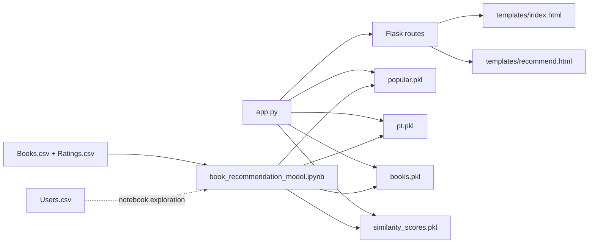

# 🗂️ Project Structure Reference

This guide maps the current repository layout. It explains the purpose of tracked files and separates application inputs from generated runtime artifacts.

## Root files

| Path | Purpose |
|---|---|
| `app.py` | Flask application, startup artifact loading, and route handlers |
| `requirements.txt` | Declared runtime Python packages |
| `.env.example` | Notes that the current app reads no environment variables |
| `.gitignore` | Excludes Python caches, environments, local settings, and editor state |
| `.gitattributes` | Configures Git LFS for CSV, pickle, and notebook files |
| `Books.csv` | Source book metadata, tracked with Git LFS |
| `Ratings.csv` | Source user-book ratings, tracked with Git LFS |
| `Users.csv` | Source user attributes, tracked with Git LFS |
| `book_recommendation_model.ipynb` | Offline exploration and model preparation notebook |
| `popular.pkl` | Popularity table consumed by the home page |
| `pt.pkl` | Title-indexed rating pivot used by recommendation lookup |
| `books.pkl` | Book metadata used to render candidate cards |
| `similarity_scores.pkl` | Similarity matrix aligned with pivot-table row order |

## Application templates

- `templates/index.html`: renders popular-book cards.
- `templates/recommend.html`: renders the title form and any recommendation cards.

Both are server-rendered Jinja templates. They currently contain inline CSS. Review accessibility and responsive behavior when changing their markup.

## Documentation and visuals

- `docs/`: product, architecture, model, data, security, privacy, accessibility, testing, deployment, and operations guidance.
- `docs/diagrams/`: Mermaid source files describing the system and data flows.
- `docs/templates/`: reusable engineering, review, incident, and release templates.
- `assets/diagrams/`: original SVG diagrams embedded in the README.

## GitHub governance and automation

- `.github/ISSUE_TEMPLATE/`: structured bug, feature, and documentation reports.
- `.github/PULL_REQUEST_TEMPLATE.md`: review checklist for code, data, model, and docs changes.
- `.github/workflows/quality.yml`: syntax, template, and documentation-presence checks.
- `.github/workflows/security.yml`: scheduled dependency audit.
- `.github/dependabot.yml`: package and Actions update schedule.
- `CODEOWNERS`: repository review ownership.
- Root policy files define conduct, contribution, security, support, license, roadmap, and change history.

## Runtime dependency relationships

## Preservation and change guidance

Do not rename or regenerate one pickle independently without validating its compatibility with the other artifacts. Preserve the LFS attributes when moving or changing large source files. If the application is refactored into packages, update this guide, README tree, architecture diagrams, import instructions, and CI checks in the same change.
