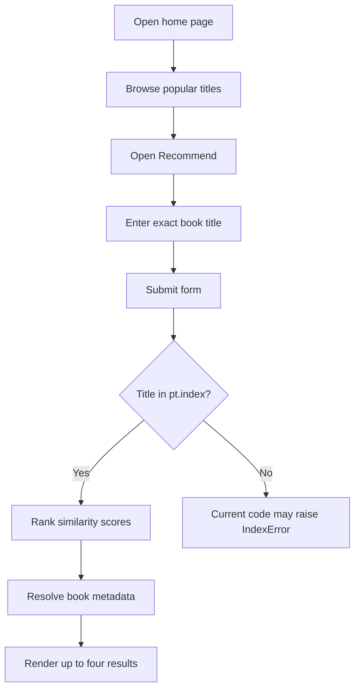

# 🔄 Application Workflows

## Visitor workflow

## Offline model workflow
1. Obtain the source CSV files and verify their rights.
2. Run the notebook in an environment with its dependencies.
3. Apply the notebook's activity thresholds and pivot transformation.
4. Compute similarity and popularity outputs.
5. Export the complete artifact set.
6. Validate schema, dimensions, ordering, and checksums.
7. Deploy all artifacts together with the matching code.

## Maintainer workflow
Inspect source and data changes, run available checks, update documentation and diagrams, review privacy/security implications, and record actual verification results. See [operations](operations.md) and [release checklist](templates/release-checklist.md).
